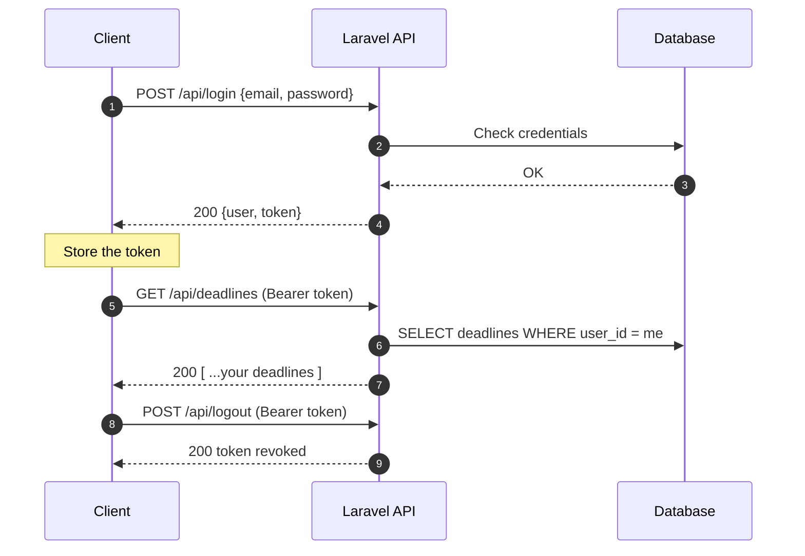
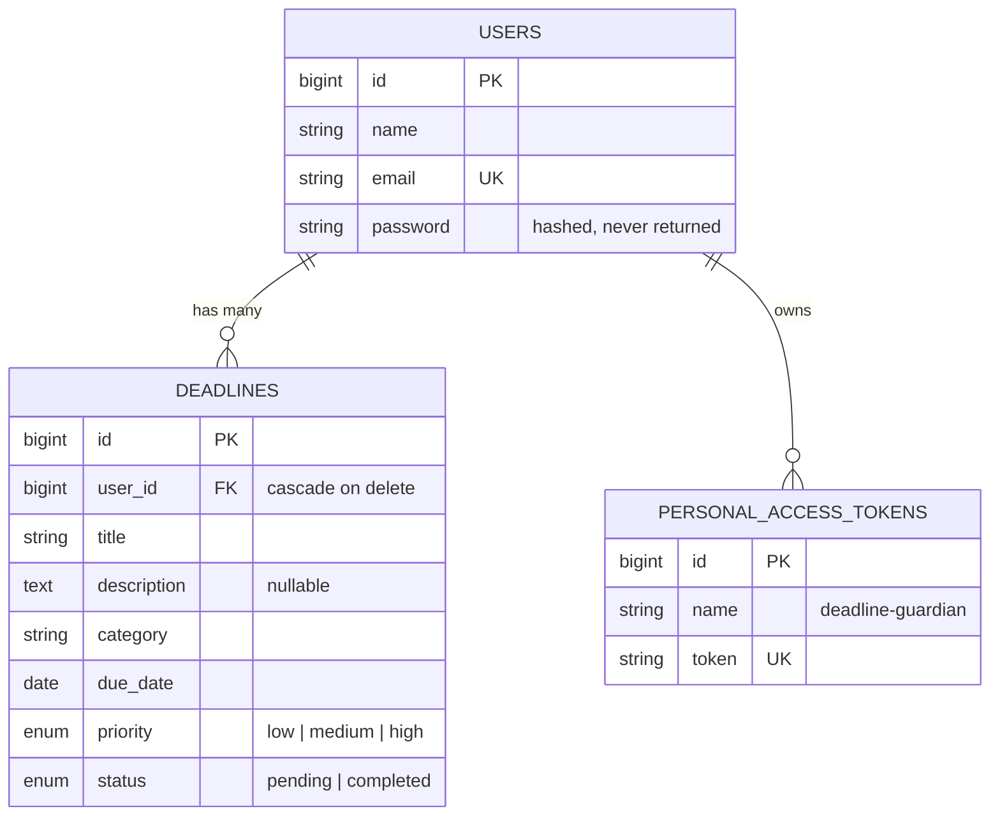

<div align="center">

# 🛡️ Deadline Guardian API

**A small, secure REST API to track personal deadlines.**
Register → get a token → manage your deadlines. That's it.


[Quick start](#-quick-start) · [Authentication](#-authentication) · [Endpoints](#-endpoints) · [Data model](#-data-model) · [Errors](#-errors)

</div>

---

## 🧭 The API in 30 seconds

```
   ┌──────────┐   1. POST /register or /login    ┌──────────────┐
   │  Client  │ ───────────────────────────────▶ │              │
   │ (React,  │ ◀─────────────── token ───────── │  Laravel API │
   │  mobile, │                                  │  + Sanctum   │
   │  curl…)  │   2. Authorization: Bearer <token>              │
   │          │ ───────────────────────────────▶ │              │
   │          │ ◀──────── JSON (your data only) ─ │              │
   └──────────┘   GET/POST/PUT/DELETE /deadlines └──────┬───────┘
                                                        │
                                                   ┌────▼─────┐
                                                   │ Database │
                                                   └──────────┘
```

| Rule | Detail |
|---|---|
| 🌐 **Base URL** | `http://127.0.0.1:8000/api` |
| 🔑 **Auth** | `Authorization: Bearer <token>` on every route except `register` and `login` |
| 📦 **Format** | Requests and responses are JSON |
| 🙈 **Privacy** | Each user only sees and edits **their own** deadlines |

> ⚠️ **Always send `Accept: application/json`.** Without it, Laravel may answer with an HTML redirect instead of a JSON error.

---

## 🚀 Quick start

```bash
composer install
cp .env.example .env
php artisan key:generate
touch database/database.sqlite      # default DB is SQLite
php artisan migrate
php artisan serve                   # → http://127.0.0.1:8000
```

Try it in two commands:

```bash
# 1. Create an account and grab the token
curl -X POST http://127.0.0.1:8000/api/register \
  -H "Accept: application/json" -H "Content-Type: application/json" \
  -d '{"name":"Sara","email":"sara@example.com","password":"secret123"}'

# 2. Use the token
curl http://127.0.0.1:8000/api/deadlines \
  -H "Accept: application/json" \
  -H "Authorization: Bearer YOUR_TOKEN"
```

---

## 🔐 Authentication

The API uses **[Laravel Sanctum](https://laravel.com/docs/sanctum) personal access tokens**.



- A token is created on **register** and on every **login**.
- Tokens **do not expire** by default (`config/sanctum.php → expiration: null`). Logging out deletes the current token.

---

## 📡 Endpoints

Legend: 🟢 `GET` · 🔵 `POST` · 🟠 `PUT` · 🔴 `DELETE` · 🔒 token required

### 👤 Account

| | Method | Route | What it does | Success |
|:-:|:-:|---|---|:-:|
| 🔓 | 🔵 `POST` | `/register` | Create an account and get a token | `201` |
| 🔓 | 🔵 `POST` | `/login` | Log in and get a token | `200` |
| 🔒 | 🔵 `POST` | `/logout` | Revoke the current token | `200` |
| 🔒 | 🟢 `GET` | `/me` | Get the logged-in user | `200` |

### ⏰ Deadlines

| | Method | Route | What it does | Success |
|:-:|:-:|---|---|:-:|
| 🔒 | 🟢 `GET` | `/deadlines` | List **your** deadlines | `200` |
| 🔒 | 🔵 `POST` | `/deadlines` | Create a deadline | `201` |
| 🔒 | 🟠 `PUT` | `/deadlines/{id}` | Update a deadline (send only the fields to change) | `200` |
| 🔒 | 🔴 `DELETE` | `/deadlines/{id}` | Delete a deadline | `200` |

---

### 📖 Request & response examples

<details>
<summary>🔵 <b>POST /register</b> — create an account</summary>

**Body**

| Field | Rules |
|---|---|
| `name` | required, string, max 255 |
| `email` | required, valid email, unique |
| `password` | required, string, min 8 |

**Response `201`**
```json
{
  "message": "Account created successfully",
  "user": { "id": 1, "name": "Sara", "email": "sara@example.com" },
  "token": "1|a8Xk...your-token"
}
```
</details>

<details>
<summary>🔵 <b>POST /login</b> — get a token</summary>

**Body:** `{ "email": "sara@example.com", "password": "secret123" }`

**Response `200`**
```json
{
  "message": "Login successful",
  "user": { "id": 1, "name": "Sara", "email": "sara@example.com" },
  "token": "2|Zp9q...your-token"
}
```

**Wrong credentials → `422`**
```json
{
  "message": "The provided credentials are incorrect.",
  "errors": { "email": ["The provided credentials are incorrect."] }
}
```
</details>

<details>
<summary>🔵 <b>POST /logout</b> and 🟢 <b>GET /me</b></summary>

`POST /logout` → `{ "message": "Logout successful" }`

`GET /me` → the current user:
```json
{ "id": 1, "name": "Sara", "email": "sara@example.com", "email_verified_at": null }
```
</details>

<details open>
<summary>🔵 <b>POST /deadlines</b> — create a deadline</summary>

**Body**

| Field | Required | Rules | Default |
|---|:-:|---|---|
| `title` | ✅ | string, max 255 | — |
| `category` | ✅ | string, max 100 | — |
| `due_date` | ✅ | date, format `YYYY-MM-DD` | — |
| `description` | ❌ | string or `null` | `null` |
| `priority` | ❌ | `low` · `medium` · `high` | `medium` |
| `status` | ❌ | `pending` · `completed` | `pending` |

```bash
curl -X POST http://127.0.0.1:8000/api/deadlines \
  -H "Accept: application/json" -H "Content-Type: application/json" \
  -H "Authorization: Bearer YOUR_TOKEN" \
  -d '{
        "title": "Submit final report",
        "category": "Work",
        "due_date": "2026-11-05",
        "priority": "high",
        "status": "pending"
      }'
```

**Response `201`**
```json
{
  "id": 7,
  "title": "Submit final report",
  "description": null,
  "category": "Work",
  "due_date": "2026-11-05T00:00:00.000000Z",
  "priority": "high",
  "status": "pending",
  "created_at": "2026-10-12T09:30:00.000000Z",
  "updated_at": "2026-10-12T09:30:00.000000Z"
}
```

> 💡 `due_date` is sent as `YYYY-MM-DD` but returned as a full ISO date-time. Keep only the first 10 characters if you need the plain date.
> 💡 Send `priority` and `status` explicitly if you need them in the `201` response: defaults are applied by the database, so they may be missing from the created object until you fetch it again.
</details>

<details>
<summary>🟢 <b>GET /deadlines</b> — list your deadlines</summary>

**Response `200`** → an array of deadline objects (same shape as above). Returns `[]` when you have none.
</details>

<details>
<summary>🟠 <b>PUT /deadlines/{id}</b> — update</summary>

Every field is optional; send only what changes. Same rules as creation.

```bash
# Mark a deadline as completed
curl -X PUT http://127.0.0.1:8000/api/deadlines/7 \
  -H "Accept: application/json" -H "Content-Type: application/json" \
  -H "Authorization: Bearer YOUR_TOKEN" \
  -d '{"status":"completed"}'
```

**Response `200`** → the updated deadline.
**`404`** if the deadline does not exist **or belongs to someone else**.
</details>

<details>
<summary>🔴 <b>DELETE /deadlines/{id}</b> — delete</summary>

**Response `200`**
```json
{ "message": "Deadline deleted successfully" }
```
**`404`** if the deadline does not exist or is not yours.
</details>

---

## 🗄️ Data model



Deleting a user also deletes all their deadlines.

---

## 🚦 Errors

| Code | Meaning | Typical cause |
|:-:|---|---|
| `200` | OK | Request succeeded |
| `201` | Created | Account or deadline created |
| `401` | Unauthenticated | Missing, invalid or revoked token |
| `404` | Not found | Unknown id, or a deadline that isn't yours |
| `422` | Validation failed | Invalid or missing fields |

**Validation errors always look like this:**

```json
{
  "message": "The title field is required. (and 1 more error)",
  "errors": {
    "title": ["The title field is required."],
    "due_date": ["The due date field does not match the format Y-m-d."]
  }
}
```

**Unauthenticated (`401`):**
```json
{ "message": "Unauthenticated." }
```

---

## 🗂️ Where things live

```
app/
├── Http/Controllers/Api/
│   ├── AuthController.php       # register · login · logout · me
│   └── DeadlineController.php   # index · store · update · destroy
├── Models/
│   ├── User.php                 # hasMany(Deadline), HasApiTokens
│   └── Deadline.php             # belongsTo(User)
routes/api.php                   # all routes, protected by auth:sanctum
database/migrations/             # users, deadlines, personal_access_tokens
```

---
